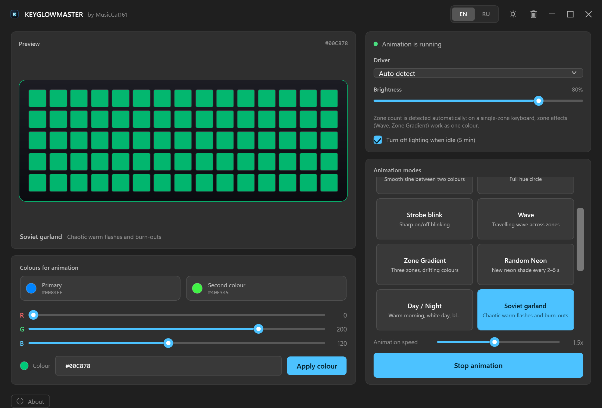

# KeyGlowMaster

[](https://github.com/MusicCat-61/KeyGlowMaster/releases)
[](https://github.com/MusicCat-61/KeyGlowMaster/releases/latest/download/KGMaster.exe)
[](https://github.com/MusicCat-61/KeyGlowMaster/actions/workflows/ci.yml)
[](LICENSE)
[](https://github.com/MusicCat-61/KeyGlowMaster/releases/tag/v1.0.5)
[](#)
[](https://dotnet.microsoft.com/download)



**English** · [Русский](README.ru.md)

A small, fast replacement for the stock Control Center on Clevo-based laptops — including Monster Notebook and the Chinese brands built on these barebones. Written in C# on .NET 10 + WPF, it talks to the keyboard through the Insyde DCHU or WMI interfaces — no drivers of its own, no background services, no installer.

WMI is used whenever it is available; if the WMI channel is disabled, the app automatically falls back to `InsydeDCHU.dll`. On other barebones (Tongfang, for example) the device will most likely not be found.

KeyGlowMaster is a fork of the [GutsV project](https://github.com/gutsv-project/Clevo-Monster-RGB-Controller): the interface was rebuilt from scratch, localisation, themes, new effects and small quality-of-life features were added. See [Credits](#credits--license).

> [!WARNING]
> **Use at your own risk.** The app has been tested, but its operation is not guaranteed. You take full responsibility for any risks of using it.

## What is inside

| | |
|---|---|
| 🪟 **Mica window** | Native Windows 11 backdrop, no system frame, custom title bar |
| 🌗 **Frost themes** | Light and dark palettes, switched on the fly from the title bar |
| 🌐 **Two languages** | English and Russian, switchable without a restart, follows the system language on first run |
| 🎨 **16 effects** | From calm breathing to a chaotic Soviet garland — list below |
| 🎯 **Colour slots** | Three colours for animations plus a separate applied colour, each with its own preview |
| ⌨️ **Live preview** | The keyboard on screen shows the colour that is actually being sent to the hardware |
| 😴 **Sleep timer** | The backlight fades out after 5 minutes of idle time and comes back on input |
| 🎛 **Global hotkeys** | Switch effects and start or stop the animation from any app — no need to open the window |
| ♻️ **Portable** | One self-contained executable, runs as administrator, auto-start through Task Scheduler |

## Effects

| Effect | What it does |
|---|---|
| Breathing | Smooth single-colour fade in and out |
| Neon pulse | Short bright flashes of a neon colour |
| Two-Color Fade | Sine fade between the two picked colours |
| Spectrum Cycle | Continuous walk around the full hue circle |
| Rainbow | Seven colours — red, orange, yellow, green, cyan, blue, violet — stepping strictly in order; on a three-zone keyboard the zones lag by a third of a step |
| Strobe blink | Sharp on/off blinking |
| Wave | Travelling colour wave across the three zones |
| Zone Gradient | Three zones, three picked colours, the palette scrolls across the keyboard |
| Random Neon | A new neon shade every 2–5 seconds |
| Day / Night | Warm in the morning, white by day, deep blue at night — follows the clock |
| Soviet garland | Chaotic warm flashes, dim-outs and burn-outs of old filament bulbs |
| Audio Sync | Lighting reacts to the music playing on the system |
| System Monitor | Colour driven by CPU load and ACPI temperature |
| Ambient (Screen Sync) | Average colour of the whole screen, weighted towards saturated areas |
| Weather Sync | Live weather colours for the city set in the panel (rain — blue, sun — yellow, clouds — grey, snow — white; steady amber while updating, steady red when the API is unreachable) |
| Dual Breathe | Two layered sine waves with different periods for a complex rhythm |

## How the colour model works

There are **four** colours in the app, and they are not the same thing:

- **Colour** — the applied colour. Press *Apply colour* and the keyboard switches to it; it is what the preview shows when no effect is running.
- **Primary / Second colour / Third colour** — the palette used by effects. Click a swatch and the RGB sliders start editing that slot; the applied colour stays untouched.

The third swatch only appears for *Zone Gradient*, the only effect that needs three zones. Values are stored in `%LOCALAPPDATA%\MusicCat.CLVKM\settings.json`.

## Zones

Zone count is detected automatically. On a single-zone keyboard the zone-based effects (*Wave*, *Zone Gradient*) fall back to one colour — the app warns about it in the device panel.

## Sleep timer

Tick **Turn off lighting when idle (5 min)** in the device card. After five minutes without mouse or keyboard input the backlight fades to black in about half a second, the animation freezes and the brightness slider shows `0%`. Any input brings the previous state back with a short fade.

## Hotkeys

The shortcuts work globally — the window may stay hidden in the tray, the current app keeps the focus:

| Shortcut | Action |
|---|---|
| `Ctrl + Alt + Page Up` | Next effect |
| `Ctrl + Alt + Page Down` | Previous effect |
| `Ctrl + Alt + Enter` | Start or stop the animation |

Every switch is confirmed by a small always-on-top toast in the corner of the screen: it shows the effect name and description for three seconds, or *Animation on* / *Animation off* when the toggle was used. Cycling the list also starts the effect when nothing was running, so the keyboard follows the shortcut immediately. The shortcuts are registered at startup and released when the app exits.

## Installation

1. Download [**`KGMaster.exe`**](https://github.com/MusicCat-61/KeyGlowMaster/releases/latest/download/KGMaster.exe) — one self-contained file, no installer and no .NET runtime required.
2. Keep it in a permanent folder, for example `C:\KeyGlowMaster`.
3. Run it as administrator — the app needs it to talk to the keyboard driver.
4. On the first run accept **Service Mode** to create a scheduled task, so Windows starts the app with the saved lighting.

> The original Control Center (`FnKey.exe`) should be running: KeyGlowMaster relies on the drivers it initialises.

## Languages and themes

Both switches live in the title bar: `EN | RU` for the interface language and the sun/moon button for the theme. The choice is remembered. The language defaults to the system one on first launch.

## Building from source

Requires the .NET 10 SDK and Windows 10/11.

```powershell
dotnet build MusicCat.CLVKM.slnx -c Release
```

or run `publish.bat` to get a self-contained folder in `Build_Output`.

### Releases

Pushing a version tag builds and publishes the app — the [release workflow](.github/workflows/release.yml) publishes a self-contained single-file `KGMaster.exe` (win-x64) on `windows-latest`, stamps the tag into its file version and attaches the executable plus its SHA-256 checksum to a GitHub release with generated notes. The download is about 75 MB: on the first start the bundle unpacks its runtime into `%TEMP%\.net\KGMaster` and reuses it afterwards.

```powershell
git tag v1.0.5
git push origin v1.0.5
```

Every push to `main` runs the [CI workflow](.github/workflows/ci.yml), which only compiles the solution — no tag, no release.

Layout: `MusicCat.CLVKM.Core` (models, settings, animation engine, weather), `MusicCat.CLVKM.Drivers` (Insyde / WMI), `MusicCat.CLVKM.UI` (WPF shell), plus a small service and a diagnostics console.

## Troubleshooting

- **Device not found** — start the original Control Center first, then restart KeyGlowMaster. In the driver box you can also force *Insyde* or *WMI* instead of auto-detect.
- **Auto-start does nothing** — open the app as administrator and accept *Service Mode* again; the old scheduled task may have been removed by a cleanup.
- **Weather stays grey** — open the **Weather** panel (it appears when the weather effect is selected), start typing a city and pick the right suggestion — the list shows the district and region, so same-named villages can be told apart. The city applies as soon as you click a suggestion (or press Enter on the highlighted one). A wrong name shows *City not found*. The effect needs internet access: it tries Open-Meteo first and falls back to `api.met.no`; while a request is running the keyboard is steady amber, and if both providers are unreachable it turns steady red until the next attempt in a couple of minutes.
- **Light goes off by itself** — uncheck the sleep timer.

## Credits & license

KeyGlowMaster is based on **GutsV Colour** by [acerhizm](https://github.com/gutsv-project/Clevo-Monster-RGB-Controller) — the drivers, the animation approach and the original idea are theirs. This fork was made by **MusicCat161** and adds a redesigned interface, Frost themes, localisation, new effects, the sleep timer and various small quality-of-life touches.

Distributed under the MIT License, see [LICENSE](LICENSE).

Contact and support: [Telegram @music_cat1](https://t.me/music_cat1) · [donate](https://dalink.to/musiccat61).
