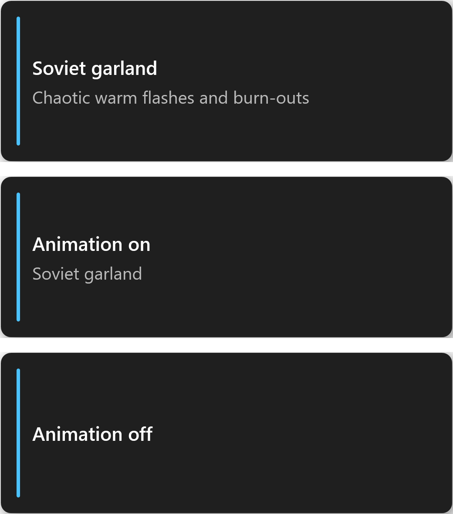

# MusicCatRGB

[](https://github.com/MusicCat-61/MusicCatRGB/releases)
[](https://github.com/MusicCat-61/MusicCatRGB/releases/latest/download/MCRGB.exe)
[](https://github.com/MusicCat-61/MusicCatRGB/actions/workflows/ci.yml)
[](LICENSE)
[](https://github.com/MusicCat-61/MusicCatRGB/releases/tag/v1.0.6.6)
[](#)
[](https://dotnet.microsoft.com/download)


*English interface · the Russian one is below on the [Russian page](README.ru.md).*

**English** · [Русский](README.ru.md)

A small, fast replacement for the stock Control Center on Clevo-based laptops — including Monster Notebook and the Chinese brands built on these barebones. Written in C# on .NET 10 + WPF, it talks to the keyboard through the Insyde DCHU or WMI interfaces — no drivers of its own, no background services, no installer.

WMI is used whenever it is available; if the WMI channel is disabled, the app automatically falls back to `InsydeDCHU.dll`. On other barebones (Tongfang, for example) the device will most likely not be found.

MusicCatRGB is a fork of the [GutsV project](https://github.com/gutsv-project/Clevo-Monster-RGB-Controller): the interface was rebuilt from scratch, localisation, themes, new effects and small quality-of-life features were added. See [Credits](#credits--license).

> [!WARNING]
> **Use at your own risk.** The app has been tested, but its operation is not guaranteed. You take full responsibility for any risks of using it.

## What is inside

| | |
|---|---|
| 🪟 **Mica window** | Native Windows 11 backdrop, no system frame, custom title bar |
| 🌗 **Frost themes** | Light and dark palettes, switched on the fly from the title bar |
| 🌐 **Two languages** | English and Russian, switchable without a restart, follows the system language on first run |
| 🎨 **16 effects** | From calm breathing to a chaotic Soviet garland — list below |
| 🎯 **Colour slots** | Three colours for animations plus a separate applied colour, each with its own preview |
| ⌨️ **Live preview** | The keyboard on screen shows the colour that is actually being sent to the hardware |
| 😴 **Sleep timer** | The backlight fades out after 5 minutes of idle time and comes back on input |
| 🎛 **Global hotkeys** | Switch effects and start or stop the animation from any app — no need to open the window |
| 🗒 **File logs** | Daily plain-text logs in `%LOCALAPPDATA%\MusicCatRGB\logs`, one button away |
| ⬆️ **Self-update** | Checks GitHub for new releases and installs them from the About window in one click |
| ♻️ **Portable** | One self-contained executable, runs as administrator, auto-start through Task Scheduler |

## Effects

| Effect | What it does |
|---|---|
| Breathing | Smooth single-colour fade in and out |
| Neon pulse | Short bright flashes of a neon colour |
| Two-Color Fade | Sine fade between the two picked colours |
| Spectrum Cycle | Continuous walk around the full hue circle |
| Rainbow | Seven colours — red, orange, yellow, green, cyan, blue, violet — stepping strictly in order; on a three-zone keyboard the zones lag by a third of a step |
| Strobe blink | Sharp on/off blinking |
| Wave | Travelling colour wave across the three zones |
| Zone Gradient | Three zones, three picked colours, the palette scrolls across the keyboard |
| Random Neon | A new neon shade every 2–5 seconds |
| Day / Night | Warm in the morning, white by day, deep blue at night — follows the clock |
| Soviet garland | Chaotic warm flashes, dim-outs and burn-outs of old filament bulbs |
| Audio Sync | Lighting reacts to the music playing on the system |
| System Monitor | Colour driven by CPU load and ACPI temperature |
| Ambient (Screen Sync) | Average colour of the whole screen, weighted towards saturated areas |
| Weather Sync | Live weather colours for the city set in the panel (rain — blue, sun — yellow, clouds — grey, snow — white; steady amber while updating, steady red when the API is unreachable) |
| Dual Breathe | Two layered sine waves with different periods for a complex rhythm |

## How the colour model works

There are **four** colours in the app, and they are not the same thing:

- **Colour** — the applied colour. Press *Apply colour* and the keyboard switches to it; it is what the preview shows when no effect is running.
- **Primary / Second colour / Third colour** — the palette used by effects. Click a swatch and the RGB sliders start editing that slot; the applied colour stays untouched.

The third swatch only appears for *Zone Gradient*, the only effect that needs three zones. Values are stored in `%LOCALAPPDATA%\MusicCatRGB\settings.json`.

## Zones

Zone count is detected automatically. On a single-zone keyboard the zone-based effects (*Wave*, *Zone Gradient*) fall back to one colour — the app warns about it in the device panel.

## Sleep timer

Tick **Turn off lighting when idle (5 min)** in the device card. After five minutes without mouse or keyboard input the backlight fades to black in about half a second, the animation freezes and the brightness slider shows `0%`. Any input brings the previous state back with a short fade.

## Typing and notification flashes

Two checkboxes in the device card make the keyboard flash briefly:

- **Flash on every keystroke (random colour)** — while you type, every keypress lights the keyboard in a new random colour from a set of ten neon tones. The same colour never comes twice in a row, and fast typing coalesces the flashes so they do not merge into one steady glow.
- **Flash on Windows notifications** — when a notification appears, the keyboard flashes in the colour from the **Notification flash colour** chip. The same R/G/B sliders and HEX box edit it: pick that chip and tune the shade like any other colour.

The flash takes the keyboard for itself and the effect steps aside: while you type the animation sits paused, and it only comes back five seconds after the last keypress — with a smooth fade, never a jump. A notification holds the keyboard for a moment (about seven tenths of a second) and hands it straight back. Typing and notifications never cut each other short: each holds the keyboard for its own time and it returns when the last delay expires. Nothing flashes while the sleep timer has the backlight off.

Flashes need to know about input and notifications, and a low-level keyboard hook cannot live in the window process: if such a hook stops answering, Windows starts dropping input on the whole desktop. So the events are collected by a **separate watcher process** (`MCRGB.exe --watcher`) that talks to the app over a **named pipe with an ACL**: the security descriptor grants the signed-in user only and remote clients are rejected, so another account on the machine cannot connect. The watcher runs only while at least one flash is on and ends together with the app.

Notifications are recognised by the window the shell creates for a toast. Microsoft only exposes the notification list to packaged apps, so this is a heuristic: it keys off the window class, the owning `ShellExperienceHost` process and the size (a toast is a small window that never takes focus, unlike the notification centre). The signatures live in one place, so a future Windows build is a one-line fix.

## Hotkeys

The shortcuts work globally — the window may stay hidden in the tray, the current app keeps the focus:

| Shortcut | Action |
|---|---|
| `Ctrl + Alt + Page Up` | Next effect |
| `Ctrl + Alt + Page Down` | Previous effect |
| `Ctrl + Alt + Enter` | Start or stop the animation |

Every switch is confirmed by a small always-on-top toast in the corner of the screen: it shows the effect name and description for three seconds, or *Animation on* / *Animation off* when the toggle was used. Cycling the list also starts the effect when nothing was running, so the keyboard follows the shortcut immediately. The shortcuts are registered at startup and released when the app exits.



*The effect toast, then the animation toggle in both states.*

## Languages and themes

Both switches live in the title bar: `EN | RU` for the interface language and the sun/moon button for the theme. The choice is remembered. The language defaults to the system one on first launch.

## Installation

1. Download [**`MCRGB.exe`**](https://github.com/MusicCat-61/MusicCatRGB/releases/latest/download/MCRGB.exe) — one self-contained file, no installer and no .NET runtime required.
2. Keep it in a permanent folder, for example `C:\MusicCatRGB`.
3. Run it as administrator — the app needs it to talk to the keyboard driver.
4. On the first run accept **Service Mode** to create a scheduled task, so Windows starts the app with the saved lighting.

> The original Control Center (`FnKey.exe`) should be running: MusicCatRGB relies on the drivers it initialises.

The X in the title bar does not close the app: the window goes to the tray, a short note says so, and the lighting keeps running. **Exit** in the tray icon menu is what really closes it.

## Updates

The app checks GitHub for new releases by itself, in three cases: a few seconds after launch, every time the window is opened from the tray, and every 15 minutes while the app stays in the tray. At most once every half hour, so the GitHub rate limit is never an issue. The check is silent: if a newer version exists, a tray notification appears; clicking it opens the About window, where the install button lives. You can also check manually at any time: **About → Check for updates**.

Nothing has to be downloaded by hand: the file is saved **into the folder the app was started from**, as `MCRGB.update.exe`. The **Finish update** button closes the process, swaps the executable and starts the app again — already on the new version. Windows locks a running `.exe` against being overwritten, so the swap is done by a separate script that waits for the process to exit, ends a stuck instance if it has to, and then relaunches the app.

When the downloaded file is already on disk — say, About was closed before the install was finished — the window offers **Finish update** straight away instead of a second download.

Worth knowing:

- **Version numbers** are compared component by component and understand both three and four digits: `1.7.0`, `1.0.6.1`, `1.0.6`. The tag `v1.0.6.0` is not an update for an installed `1.0.6.1` — that is the same version.
- **A read-only folder** (`Program Files`) is reported honestly, with a suggestion to move `MCRGB.exe` somewhere writable, for example `C:\MusicCatRGB`.
- **No network** — the check quietly goes to the log and the lighting carries on. No error dialog at startup; after a failed attempt the app tries again a few minutes later.
- **An update that did not install** is announced on the next start, with the details in `logs\update-apply.log`. The downloaded file is kept, so the install can be retried without fetching it again.
- **The check is anonymous**, but GitHub rate-limits requests per IP; when the limit is hit the About window says so.

## Logs

Every run writes a plain-text log to `%LOCALAPPDATA%\MusicCatRGB\logs\` — one file per day (`musiccatrgb-20261031.txt`), the last 14 are kept. The **Logs** button in the footer opens that folder; it is created on first use.

Each entry is tagged with a category, so the file can be followed with a filter:

| Category | What it records |
|---|---|
| `[hotkey]` | Shortcut registration and every press: effect switched, animation started or stopped |
| `[effect]` | Effect selection and start/stop, with brightness, speed and zone |
| `[color]` | Colour-slot edits, the static colour sent to the keyboard and weather-location changes |
| `[mode]` | Theme, language, driver mode, zone, brightness, speed, sleep timer and the state restored at startup |
| `[driver]` | The driver handshake, plus the raw status codes the Insyde DLL answers with |
| `[update]` | Release checks, the version found, the download, the restart that installs it and what a failed swap left behind |
| `[flash]` | Flashes switched on or off, the animation pausing for a flash and coming back |
| `[watcher]` | The input watcher: the channel, detected notifications, connection failures |

```text
2026-10-31 21:42:07.385 [INF] Driver connected: InsydeDriver (single-zone) after 1 attempt(s)
2026-10-31 21:42:07.401 [INF] [effect] Animation started: Погодная подсветка (Weather Sync), brightness=100%, speed=1,5x, zone=All
2026-10-31 21:42:07.427 [INF] [driver] Insyde: first frame statuses: SetDCHU_Data(103)=103, …
```

Sliders change their value hundreds of times per drag, so those entries are coalesced — the log keeps the value you settled on, not every pixel. Identical driver faults are reported once, then summarised, so a busy animation cannot flood the file.

> `SetDCHU_Data(103)` answering `103` (and `WriteAppSettings` answering `1`) is normal on Insyde hardware: the vendor DLL echoes a status instead of returning 0. It is logged as information, not as an error.

The log is UTF-8. Older tools that assume the system code page may show Cyrillic effect names incorrectly — Notepad, VS Code and `Get-Content -Encoding utf8` read it correctly.

## Building from source

Requires the .NET 10 SDK and Windows 10/11.

```powershell
dotnet build MusicCat.CLVKM.slnx -c Release
```

or run `publish.bat` to get a self-contained folder in `Build_Output`.

### Releases

Pushing a version tag builds and publishes the app — the [release workflow](.github/workflows/release.yml) publishes a self-contained single-file `MCRGB.exe` (win-x64) on `windows-latest`, stamps the tag into its file version and attaches the executable plus its SHA-256 checksum to a GitHub release with generated notes. The download is about 75 MB: on the first start the bundle unpacks its runtime into `%TEMP%\.net\MCRGB` and reuses it afterwards.

```powershell
git tag v1.0.6.6
git push origin v1.0.6.6
```

Every push to `main` runs the [CI workflow](.github/workflows/ci.yml), which only compiles the solution — no tag, no release.

Layout: `MusicCat.CLVKM.Core` (models, settings, animation engine, weather), `MusicCat.CLVKM.Drivers` (Insyde / WMI), `MusicCat.CLVKM.UI` (WPF shell), plus a small service and a diagnostics console.

## Troubleshooting

- **Device not found** — start the original Control Center first, then restart MusicCatRGB. In the driver box you can also force *Insyde* or *WMI* instead of auto-detect.
- **Auto-start does nothing** — open the app as administrator and accept *Service Mode* again; the old scheduled task may have been removed by a cleanup.
- **Weather stays grey** — open the **Weather** panel (it appears when the weather effect is selected), start typing a city and pick the right suggestion — the list shows the district and region, so same-named villages can be told apart. The city applies as soon as you click a suggestion (or press Enter on the highlighted one). A wrong name shows *City not found*. The effect needs internet access: it tries Open-Meteo first and falls back to `api.met.no`; while a request is running the keyboard is steady amber, and if both providers are unreachable it turns steady red until the next attempt in a couple of minutes.
- **Light goes off by itself** — uncheck the sleep timer.

## Credits & license

MusicCatRGB is based on **GutsV Colour** by [acerhizm](https://github.com/gutsv-project/Clevo-Monster-RGB-Controller) — the drivers, the animation approach and the original idea are theirs. This fork was made by **MusicCat161** and adds a redesigned interface, Frost themes, localisation, new effects, the sleep timer and various small quality-of-life touches.

Distributed under the MIT License, see [LICENSE](LICENSE).

Contact and support: [Telegram @music_cat1](https://t.me/music_cat1) · [donate](https://dalink.to/musiccat61).
