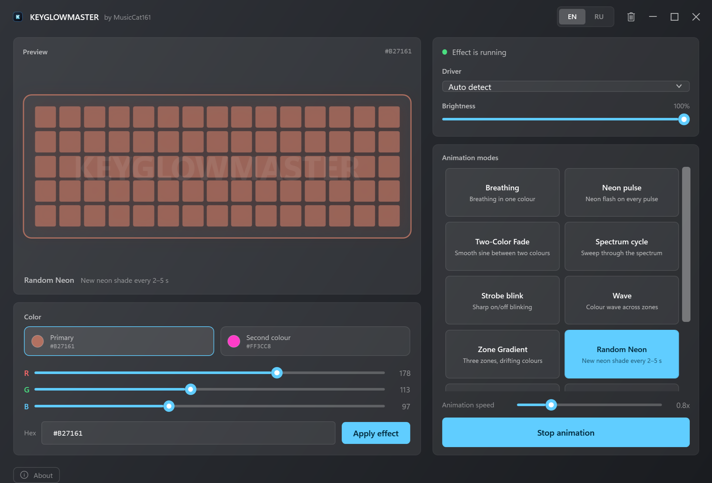

# KeyGlowMaster by MusicCat161 🎨
> **The Next-Gen RGB Control Center for Monster High & Clevo Laptops**

**KeyGlowMaster by MusicCat161** is a lightweight, high-performance, and aesthetically stunning alternative to the stock Control Center software for managing your laptop's RGB keyboard. Built with modern .NET technologies, it eliminates lag, offers advanced animations, and provides a seamless user experience.

## ⚡ Why KeyGlowMaster?
The default Control Center software is often bloated, slow, and resource-heavy. KeyGlowMaster changes the game:
*   **Zero Latency:** Custom `AsyncDriverQueue` technology ensures instant lighting response without freezing the UI.
*   **Ultra Lightweight:** Consumes minimal RAM and CPU (<0.1% CPU in background).
*   **System Integration:** Works alongside or replaces your existing RGB controls.

## 🚀 Key Features
*   **🎵 Audio Sync:** Turn your keyboard into a visualizer that reacts to your music and system audio in real-time.
*   **🖥️ Ambient Lighting (Screen Sync):**
    *   **Full 100% Screen Sync:** Edge-to-edge capture with High-DPI (PerMonitorV2) support for accurate border, window, and full-screen tracking.
    *   **Chroma-Weighted Sampling:** Colorful, saturated pixels are given quadratic priority over white backgrounds, borders, menus, and subtitles.
    *   **HSV Saturation & Vibrance Boost:** Enhances color depth so keyboard LEDs display rich, vibrant shades instead of washed-out pastel or milky white light.
    *   **Smart Document & Blackout Modes:** Intelligently switches to soft, eye-friendly neutral white on monochrome/document screens (Word, PDF) and dims to pitch black during dark movie scenes.
    *   **Cinematic Smoothing:** 60 FPS Exponential Moving Average (EMA) transitions eliminate stutter and harsh flickering.
*   **🌡️ System Monitor (Heatmap):**
    *   **Microsecond CPU Load:** Instantaneous CPU monitoring via direct low-level kernel APIs (`GetSystemTimes`).
    *   **Hardware Temperature:** Real-time ACPI thermal zone temperature tracking (Celsius).
    *   **5-Stop Heatmap Gradient:** Smooth continuous transitions (Cyan -> Green -> Yellow -> Orange -> Red) with dynamic smoothing.
*   **💾 Auto-Persistence:** Remembers your exact color, brightness, and animation state after reboot.
*   **🤖 Smart Start:** Automatically starts with Windows (Bypasses UAC via Task Scheduler) and waits for hardware initialization.
*   **✨ Windows 11 Mica UI:** Fluent-looking window with the native Mica backdrop (solid fallback on Windows 10).
*   **🌐 English / Русский:** Live language switch in the title bar — the whole interface and the tray menu update instantly; the choice is remembered.
*   **🎨 Two colour slots:** click the primary or secondary swatch and the RGB sliders / hex field immediately switch to that colour.
*   **🌌 Animation Engine (15 effects):**
    *   **Breathe / Fresh Breathe:** Smooth, organic fading effects.
    *   **Color Shift / Transform:** Seamlessly transitions between colors.
    *   **Pulsating Blink:** Alert-style effects.
    *   **Two-Color Fade:** Gentle sine fade between the two picked colors.
    *   **Zone Gradient:** Left, centre and right zones with drifting colors.
    *   **Random Neon:** A new neon shade every 2–5 seconds.
    *   **Day / Night:** Warm morning, white day, cool blue evening — follows the system clock.
    *   **Weather Sync:** Live conditions via Open-Meteo (rain — blue, sun — yellow, clouds — grey, snow — white); refreshes every 15 minutes.
    *   **Dual Breathe:** Two layered sine waves with different periods for a complex, never-quite-repeating rhythm.
    *   **Soviet Garland:** chaotic warm flashes, dim-outs and burn-outs, like an old filament garland.

## 💻 Compatibility
Designed primarily for **Monster Notebook** and **Clevo** chassis laptops using:
*   **Insyde DCHU Drivers** (Most modern models)
*   **WMI Interface** (Older/Specific models)
*   *Note: Auto-detects Single-Zone and Multi-Zone layouts.*
*   *Note: on a single-zone keyboard, zone-based effects (Wave, Zone Gradient) work as one colour — the app warns about this in the device panel.*

## 📦 Installation & Setup
**KeyGlowMaster is a portable application.** No installer wizard required.

1.  **Download** the latest release.
2.  Extract the folder to a permanent location (e.g., `C:\KeyGlowMaster`).
3.  Run **`KGMaster.exe`**.
4.  **First Run:** You will be asked to enable **Service Mode**. Click **"Yes"**.
    *   *This allows KeyGlowMaster to start automatically with Windows without annoying admin prompts.*

> **Important:** Keep your original Control Center (FnKey.exe) running in the background. KeyGlowMaster relies on the low-level drivers initialized by the manufacturer's software.

## 🎮 Usage Guide
*   **System Tray:** KeyGlowMaster runs silently in the background. Double-click the icon near your clock to open the dashboard.
*   **Trash Icon:** Use the "Cleanup" button in the title bar to reset all settings and remove the auto-start service if you wish to uninstall.
*   **Animations:** Select an animation from the list and click "START".
*   **Static Color:** Stop any animation to apply a static color using the RGB sliders or Hex code.

## 🛠️ Troubleshooting
*   **"Device Not Found":** Ensure your laptop's original Control Center is running. Restart KeyGlowMaster.
*   **Auto-Start Not Working:** Open KeyGlowMaster, click the Trash icon (Cleanup), then restart the app and accept the "Service Mode" prompt.

## ⚖️ Disclaimer
This software interacts with hardware drivers. While extensively tested, use it at your own risk. The developer is not responsible for any hardware incompatibilities.

---
*Made by MusicCat161. Inspired by the [GutsV project](https://github.com/gutsv-project/Clevo-Monster-RGB-Controller).*
