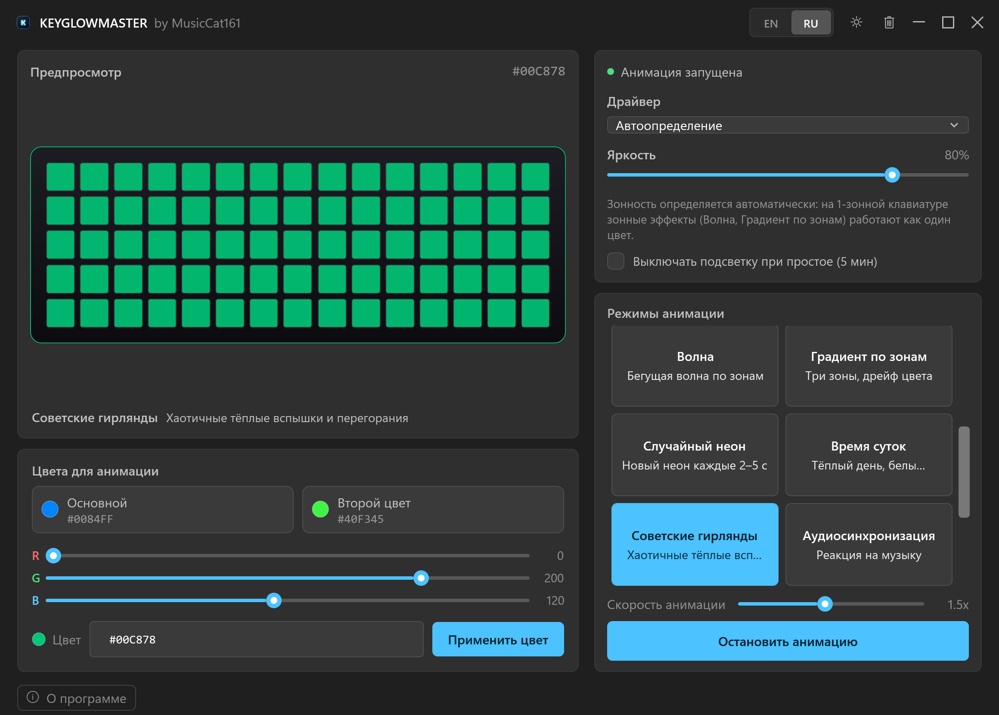

# KeyGlowMaster

[](https://github.com/MusicCat-61/KeyGlowMaster/releases)
[](https://github.com/MusicCat-61/KeyGlowMaster/releases/latest/download/KGMaster.exe)
[](https://github.com/MusicCat-61/KeyGlowMaster/actions/workflows/ci.yml)
[](LICENSE)
[](#)
[](https://dotnet.microsoft.com/download)



[English](README.md) · **Русский**

Небольшая и быстрая замена штатному Control Center для ноутбуков Clevo и Monster Notebook. Написана на C# (.NET 10 + WPF), работает с подсветкой через интерфейсы Insyde DCHU или WMI — своих драйверов не ставит, службу в систему не внедряет, установщика не требует.

KeyGlowMaster — форк проекта [GutsV](https://github.com/gutsv-project/Clevo-Monster-RGB-Controller): интерфейс переписан с нуля, добавлены локализация, темы, новые эффекты и разные мелочи. Подробности — в разделе [Авторы и лицензия](#авторы-и-лицензия).

## Что внутри

| | |
|---|---|
| 🪟 **Окно Mica** | Нативная подложка Windows 11, без системной рамки, собственный заголовок |
| 🌗 **Темы Frost** | Светлая и тёмная палитры, переключаются на лету в заголовке |
| 🌐 **Два языка** | Русский и английский, переключение без перезапуска, при первом старте — по языку системы |
| 🎨 **15 эффектов** | От спокойного дыхания до хаотичной советской гирлянды — список ниже |
| 🎯 **Слоты цвета** | Три цвета для анимаций и отдельный применяемый цвет, у каждого свой предпросмотр |
| ⌨️ **Живое превью** | Клавиатура на экране показывает цвет, который реально уходит в железо |
| 😴 **Таймер сна** | Через 5 минут простоя подсветка плавно гаснет и возвращается при вводе |
| ♻️ **Портативность** | Один самодостаточный файл, запуск от администратора, автозапуск через Планировщик задач |

## Эффекты

| Эффект | Что делает |
|---|---|
| Дыхание | Плавное затухание и разгорание одного цвета |
| Неоновый пульс | Короткие яркие вспышки неонового оттенка |
| Перелив двух цветов | Синусоидальный переход между двумя выбранными цветами |
| Цикл спектра | Непрерывный проход по всему кругу оттенков |
| Стробоскоп | Резкое мигание включением и выключением |
| Волна | Бегущая цветовая волна по трём зонам |
| Градиент по зонам | Три зоны, три выбранных цвета, палитра прокручивается по клавиатуре |
| Случайный неон | Новый неоновый оттенок каждые 2–5 секунд |
| Время суток | Утром тепло, днём белый, ночью глубокий синий — по системным часам |
| Советские гирлянды | Хаотичные тёплые вспышки, просадки и перегорания старых лампочек |
| Аудиосинхронизация | Подсветка реагирует на музыку, играющую в системе |
| Монитор системы | Цвет зависит от нагрузки CPU и температуры ACPI |
| Синхронизация с экраном | Цвет берётся с краёв экрана |
| Погодная подсветка | Живая погода в выбранном городе: дождь — синий, солнце — жёлтый, облака — серый, снег — белый |
| Двойное дыхание | Две наложенные синусоиды с разными периодами дают сложный ритм |

## Как устроен цвет

В приложении **четыре** цвета, и это не одно и то же:

- **Цвет** — применяемый. Нажали «Применить цвет» — клавиатура переключилась на него; именно его показывает превью, когда ничего не запущено.
- **Основной / Второй цвет / Третий цвет** — палитра для эффектов. Клик по плашке переводит ползунки R/G/B на этот слот, применяемый цвет при этом не меняется.

Третья плашка появляется только у «Градиента по зонам» — единственного эффекта, которому нужны три зоны. Всё хранится в `%LOCALAPPDATA%\MusicCat.CLVKM\settings.json`.

## Зоны

Количество зон определяется автоматически. На 1-зонной клавиатуре зонные эффекты («Волна», «Градиент по зонам») работают как один цвет — приложение честно предупреждает об этом в карточке устройства.

## Таймер сна

Поставьте галочку **«Выключать подсветку при простое (5 мин)»** в карточке устройства. После пяти минут без мыши и клавиатуры подсветка за полсекунды уходит в ноль, анимация замирает, а слайдер яркости показывает `0%`. Любой ввод возвращает прежнее состояние коротким плавным разгоранием.

## Установка

1. Скачайте [**`KGMaster.exe`**](https://github.com/MusicCat-61/KeyGlowMaster/releases/latest/download/KGMaster.exe) — один самодостаточный файл, установщик и .NET Runtime не нужны.
2. Положите его в постоянную папку, например `C:\KeyGlowMaster`.
3. Запустите от имени администратора — иначе не будет доступа к драйверу клавиатуры.
4. При первом запуске согласитесь на **режим службы**: приложение создаст задачу в Планировщике, чтобы Windows поднимала его с сохранённой подсветкой.

> Желательно, чтобы оригинальный Control Center (`FnKey.exe`) был запущен: KeyGlowMaster опирается на драйверы, которые тот инициализирует.

## Язык и тема

Оба переключателя — в заголовке окна: `EN | RU` для языка и кнопка солнце/луна для темы. Выбор запоминается, при первом запуске язык берётся из системы.

## Сборка из исходников

Нужен .NET 10 SDK и Windows 10/11.

```powershell
dotnet build MusicCat.CLVKM.slnx -c Release
```

Либо запустите `publish.bat` — получите самодостаточную папку в `Build_Output`.

### Релизы

Пуш тега запускает сборку и публикацию: [workflow](.github/workflows/release.yml) собирает самодостаточный однофайловый `KGMaster.exe` под `win-x64` на `windows-latest`, проставляет ему версию из тега и прикрепляет исполняемый файл вместе с контрольной суммой SHA-256 к релизу с автоматически составленным списком изменений. Скачивание — около 75 МБ: при первом запуске бандл распаковывает среду выполнения в `%TEMP%\.net\KGMaster` и дальше переиспользует её.

```powershell
git tag v1.0.1
git push origin v1.0.1
```

Каждый пуш в `main` запускает [CI workflow](.github/workflows/ci.yml) — только сборку решения, без тега и релиза.

Состав решения: `MusicCat.CLVKM.Core` (модели, настройки, движок анимаций, погода), `MusicCat.CLVKM.Drivers` (Insyde / WMI), `MusicCat.CLVKM.UI` (оболочка WPF), плюс небольшая служба и консоль диагностики.

## Если что-то не работает

- **«Устройство не найдено»** — сначала запустите оригинальный Control Center, потом перезапустите KeyGlowMaster. В списке драйверов можно принудительно выбрать *Insyde* или *WMI* вместо автоопределения.
- **Автозапуск не срабатывает** — запустите приложение от администратора и снова согласитесь на режим службы: старая задача могла быть удалена очисткой.
- **Погода остаётся серой** — откройте карточку **«Погода»** (появляется при выборе погодного эффекта), введите город и нажмите «Задать». При ошибке в названии появится «Город не найден». Эффекту нужен интернет: сначала запрос идёт в Open-Meteo, при неудаче — в `api.met.no`; если недоступны оба, точка рядом со статусом краснеет, а подсветка остаётся нейтральной до следующей попытки через пару минут.
- **Подсветка гаснет сама** — снимите галочку таймера сна.

## Авторы и лицензия

KeyGlowMaster основан на **GutsV Colour** от [acerhizm](https://github.com/gutsv-project/Clevo-Monster-RGB-Controller) — драйверы, подход к анимациям и сама идея принадлежат ему. Форк сделал **MusicCat161**: переработанный интерфейс, темы Frost, локализация, новые эффекты и таймер сна.

Распространяется под лицензией MIT, см. [LICENSE](LICENSE).
