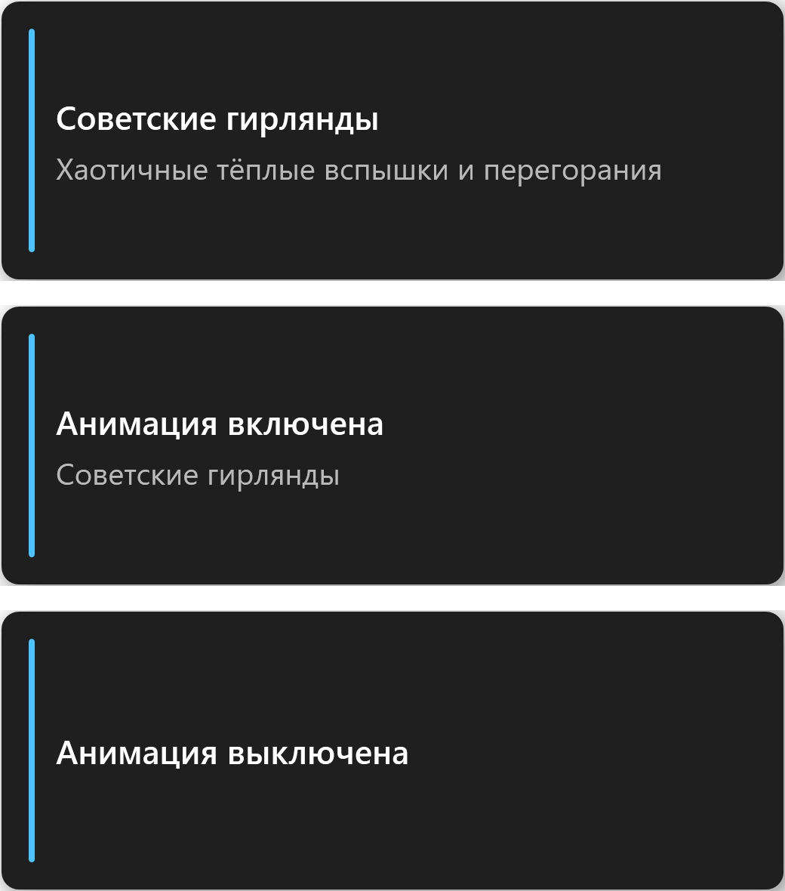

# MusicCatRGB

[](https://github.com/MusicCat-61/MusicCatRGB/releases)
[](https://github.com/MusicCat-61/MusicCatRGB/releases/latest/download/MCRGB.exe)
[](https://github.com/MusicCat-61/MusicCatRGB/actions/workflows/ci.yml)
[](LICENSE)
[](https://github.com/MusicCat-61/MusicCatRGB/releases/tag/v1.0.6.4)
[](#)
[](https://dotnet.microsoft.com/download)


*Русский интерфейс; английский — на [английской странице](README.md).*

[English](README.md) В· **Р СѓСЃСЃРєРёР№**

Небольшая и быстрая замена штатному Control Center для ноутбуков на базе Clevo — включая Monster Notebook и китайские бренды, которые собираются на этих платах. Написана на C# (.NET 10 + WPF), работает с подсветкой через интерфейсы Insyde DCHU или WMI — своих драйверов не ставит, службу в систему не внедряет, установщика не требует.

WMI используется, когда он доступен; если WMI-канал отключён, приложение автоматически переходит на `InsydeDCHU.dll`. На других платах (например, Tongfang) устройство, скорее всего, не найдётся.

MusicCatRGB — форк проекта [GutsV](https://github.com/gutsv-project/Clevo-Monster-RGB-Controller): интерфейс переписан с нуля, добавлены локализация, темы, новые эффекты и разные мелочи. Подробности — в разделе [Авторы и лицензия](#авторы-и-лицензия).

> [!WARNING]
> **Предупреждение.** Использование — на ваш страх и риск. Приложение тестировалось, но его работа не гарантируется. Все риски, связанные с использованием, несёт пользователь.

## Что внутри

| | |
|---|---|
| 🪟 **Окно Mica** | Нативная подложка Windows 11, без системной рамки, собственный заголовок |
| 🌗 **Темы Frost** | Светлая и тёмная палитры, переключаются на лету в заголовке |
| 🌐 **Два языка** | Русский и английский, переключение без перезапуска, при первом старте — по языку системы |
| 🎨 **16 эффектов** | От спокойного дыхания до хаотичной советской гирлянды — список ниже |
| 🎯 **Слоты цвета** | Три цвета для анимаций и отдельный применяемый цвет, у каждого свой предпросмотр |
| ⌨️ **Живое превью** | Клавиатура на экране показывает цвет, который реально уходит в железо |
| 😴 **Таймер сна** | Через 5 минут простоя подсветка плавно гаснет и возвращается при вводе |
| 🎛 **Горячие клавиши** | Переключение эффектов и запуск анимации из любого приложения — окно открывать не нужно |
| 🗒 **Файловые логи** | Ежедневные текстовые логи в `%LOCALAPPDATA%\MusicCatRGB\logs`, открываются одной кнопкой |
| ⬆️ **Обновление из приложения** | Проверка новых релизов на GitHub и установка в один клик прямо из окна «О программе» |
| ♻️ **Портативность** | Один самодостаточный файл, запуск от администратора, автозапуск через Планировщик задач |

## Эффекты

| Эффект | Что делает |
|---|---|
| Дыхание | Плавное затухание и разгорание одного цвета |
| Неоновый пульс | Короткие яркие вспышки неонового оттенка |
| Перелив двух цветов | Синусоидальный переход между двумя выбранными цветами |
| Цикл спектра | Непрерывный проход по всему кругу оттенков |
| Радуга | Семь цветов — красный, оранжевый, жёлтый, зелёный, голубой, синий, фиолетовый — строго по кругу; на 3-зонной клавиатуре зоны отстают на треть шага |
| Стробоскоп | Резкое мигание включением и выключением |
| Волна | Бегущая цветовая волна по трём зонам |
| Градиент по зонам | Три зоны, три выбранных цвета, палитра прокручивается по клавиатуре |
| Случайный неон | Новый неоновый оттенок каждые 2–5 секунд |
| Время суток | Утром тепло, днём белый, ночью глубокий синий — по системным часам |
| Советские гирлянды | Хаотичные тёплые вспышки, просадки и перегорания старых лампочек |
| Аудиосинхронизация | Подсветка реагирует на музыку, играющую в системе |
| Монитор системы | Цвет зависит от нагрузки CPU и температуры ACPI |
| Синхронизация с экраном | Средний цвет всего экрана с упором на насыщенные области |
| Погодная подсветка | Живая погода в выбранном городе: дождь — синий, солнце — жёлтый, облака — серый, снег — белый; ровный янтарный — идёт запрос, ровный красный — нет связи с API |
| Двойное дыхание | Две наложенные синусоиды с разными периодами дают сложный ритм |

## Как устроен цвет

В приложении **четыре** цвета, и это не одно и то же:

- **Цвет** — применяемый. Нажали «Применить цвет» — клавиатура переключилась на него; именно его показывает превью, когда ничего не запущено.
- **Основной / Второй цвет / Третий цвет** — палитра для эффектов. Клик по плашке переводит ползунки R/G/B на этот слот, применяемый цвет при этом не меняется.

Третья плашка появляется только у «Градиента по зонам» — единственного эффекта, которому нужны три зоны. Всё хранится в `%LOCALAPPDATA%\MusicCatRGB\settings.json`.

## Р—РѕРЅС‹

Количество зон определяется автоматически. На 1-зонной клавиатуре зонные эффекты («Волна», «Градиент по зонам») работают как один цвет — приложение честно предупреждает об этом в карточке устройства.

## Таймер сна

Поставьте галочку **«Выключать подсветку при простое (5 мин)»** в карточке устройства. После пяти минут без мыши и клавиатуры подсветка за полсекунды уходит в ноль, анимация замирает, а слайдер яркости показывает `0%`. Любой ввод возвращает прежнее состояние коротким плавным разгоранием.

## Вспышки при наборе и уведомлениях

Две галочки в карточке устройства заставляют клавиатуру коротко вспыхивать поверх текущего эффекта:

- **«Вспышка при наборе (случайный цвет)»** — пока вы печатаете, каждый клавиатурный ввод подсвечивает клавиши новым случайным цветом из набора десяти неоновых оттенков. Два одинаковых цвета подряд не выпадают; при быстром наборе вспышки склеиваются, чтобы не превращаться в сплошное свечение.
- **«Вспышка при уведомлениях Windows»** — при появлении уведомления клавиатура вспыхивает цветом из карточки **«Цвет вспышки»**. Один и тот же набор ползунков R/G/B и поле HEX правит и его: выберите чип «Цвет вспышки» и настройте оттенок как любой другой.

Вспышка рисуется поверх анимации: эффект не останавливается и возвращается сам. Во время таймера сна вспышек нет — спящая подсветка не просыпается от нажатия.

Вспышки требуют знать о вводе и уведомлениях, а низкоуровневый хук клавиатуры нельзя держать в процессе с окном: если такой хук перестанет отвечать, Windows начнёт терять ввод на всём рабочем столе. Поэтому события собирает **отдельный процесс-наблюдатель** (`MCRGB.exe --watcher`), а с приложением он общается через **именованный канал с ACL**: дескриптор доступа выдаётся только текущему пользователю, удалённые клиенты отклоняются. Другой учётной записи на этой машине канал недоступен. Наблюдатель запускается только когда включена хотя бы одна вспышка и завершается вместе с приложением.

Уведомления определяются по окну, которое оболочка создаёт для тоста. Microsoft отдаёт список уведомлений только упакованным приложениям, поэтому это эвристика — она опирается на класс окна, процесс `ShellExperienceHost` и размер (уведомление — маленькое окно, не забирающее фокус, в отличие от центра уведомлений). Признаки собраны в одном месте, так что новые сборки Windows правятся одной строкой.

## Горячие клавиши

Сочетания работают глобально — окно может быть свёрнуто в трей, а фокус остаётся в текущей программе:

| Сочетание | Действие |
|---|---|
| `Ctrl + Alt + Page Up` | Следующий эффект |
| `Ctrl + Alt + Page Down` | Предыдущий эффект |
| `Ctrl + Alt + Enter` | Включить или выключить анимацию |

Каждое переключение подтверждается небольшой плашкой поверх всех окон в углу экрана: три секунды с названием и описанием эффекта либо *«Анимация включена»* / *«Анимация выключена»* для переключателя. Если анимация была выключена, перебор списка сразу запускает выбранный эффект. Сочетания регистрируются при запуске и снимаются при выходе из приложения.



*Плашка эффекта, затем переключатель анимации в обоих состояниях.*

## Язык и тема

Оба переключателя — в заголовке окна: `EN | RU` для языка и кнопка солнце/луна для темы. Выбор запоминается, при первом запуске язык берётся из системы.

## Установка

1. Скачайте [**`MCRGB.exe`**](https://github.com/MusicCat-61/MusicCatRGB/releases/latest/download/MCRGB.exe) — один самодостаточный файл, установщик и .NET Runtime не нужны.
2. Положите его в постоянную папку, например `C:\MusicCatRGB`.
3. Запустите от имени администратора — иначе не будет доступа к драйверу клавиатуры.
4. При первом запуске согласитесь на **режим службы**: приложение создаст задачу в Планировщике, чтобы Windows поднимала его с сохранённой подсветкой.

> Желательно, чтобы оригинальный Control Center (`FnKey.exe`) был запущен: MusicCatRGB опирается на драйверы, которые тот инициализирует.

## Обновления

Приложение само проверяет новые релизы на GitHub и делает это в трёх случаях: через несколько секунд после запуска, при каждом открытии окна из трея и раз в 15 минут, пока приложение остаётся в трее. Раз в полчаса — не чаще, чтобы не упираться в лимит запросов GitHub. Проверка тихая: если версия новее, всплывает уведомление в трее, клик по нему открывает «О программе», где живёт кнопка установки. Проверить вручную можно в любой момент там же — **«О программе» → Проверить обновления**.

Установка не требует ничего скачивать вручную: файл загружается **в ту же папку, откуда запущено приложение**, под именем `MCRGB.update.exe`. Кнопка **«Завершить обновление»** закрывает процесс, подменяет исполняемый файл и запускает приложение заново — уже новой версии. Windows блокирует перезапись работающего `.exe`, поэтому подмену выполняет отдельный скрипт: он дожидается выхода процесса, при необходимости снимает зависший экземпляр и только потом перезапускает программу.

Если скачанный файл уже лежит на диске — например, «О программе» закрыли, не доведя установку до конца, — окно сразу предложит **«Завершить обновление»**, а не вторую загрузку.

Что стоит знать:

- **Номер версии** сравнивается почленно и одинаково понимает три и четыре цифры: `1.7.0`, `1.0.6.1`, `1.0.6`. Тег `v1.0.6.0` не считается обновлением для установленной `1.0.6.1` — это одна и та же версия.
- **Папка только для чтения** (`Program Files`) — приложение честно скажет об этом и предложит перенести `MCRGB.exe` туда, где запись разрешена, например в `C:\MusicCatRGB`.
- **Сеть недоступна** — проверка молча уходит в лог, подсветка работает как обычно. Никаких диалогов с ошибкой при старте; после неудачной попытки приложение повторит её через несколько минут.
- **Обновление не встало** — при следующем запуске появится уведомление, а подробности попадут в `logs\update-apply.log`. Скачанный файл при этом сохраняется: установку можно повторить, не загружая его заново.
- **Проверка анонимная**, но GitHub ограничивает частоту запросов с одного IP; при исчерпании лимита приложение скажет об этом в окне «О программе».

## Логи

Каждый запуск пишет обычный текстовый лог в `%LOCALAPPDATA%\MusicCatRGB\logs\` — один файл на день (`musiccatrgb-20261031.txt`), хранятся последние 14. Кнопка **«Журнал»** в нижней панели открывает эту папку; она создаётся при первом обращении.

Каждая запись помечена категорией — по ней удобно фильтровать файл:

| Категория | Что попадает в лог |
|---|---|
| `[hotkey]` | Регистрация сочетаний и каждое нажатие: смена эффекта, запуск и остановка анимации |
| `[effect]` | Выбор эффекта и старт/стоп, вместе с яркостью, скоростью и зоной |
| `[color]` | Правка цветовых слотов, отправка статичного цвета на клавиатуру, смена города для погоды |
| `[mode]` | Тема, язык, режим драйвера, зона, яркость, скорость, таймер сна и состояние, восстановленное при запуске |
| `[driver]` | Подключение драйвера и «сырые» коды ответа DLL Insyde |
| `[update]` | Проверка релизов, найденная версия, загрузка файла, перезапуск для установки и разбор неудачной подмены |
| `[flash]` | Включение и выключение вспышек при наборе и уведомлениях |
| `[watcher]` | Наблюдатель за вводом: канал, найденные уведомления, сбои подключения |

```text
2026-10-31 21:42:07.385 [INF] Driver connected: InsydeDriver (single-zone) after 1 attempt(s)
2026-10-31 21:42:07.401 [INF] [effect] Animation started: Погодная подсветка (Weather Sync), brightness=100%, speed=1,5x, zone=All
2026-10-31 21:42:07.427 [INF] [driver] Insyde: first frame statuses: SetDCHU_Data(103)=103, …
```

Ползунки меняют значение сотни раз за одно перетаскивание, поэтому такие записи склеиваются: в лог попадает то значение, на котором вы остановились, а не каждый пиксель. Одинаковые сбои драйвера пишутся один раз, дальше идут сводкой, — анимация не может залить файл.

> Ответ `103` от `SetDCHU_Data(103)` (и `1` от `WriteAppSettings`) для Insyde — это норма: вендорная DLL возвращает эхо статуса, а не 0. Пишется как информация, а не как ошибка.

Лог в UTF-8. Старые программы, которые читают в системной кодовой странице, могут показать русские названия эффектов некорректно — «Блокнот», VS Code и `Get-Content -Encoding utf8` читают правильно.

## РЎР±РѕСЂРєР° РёР· РёСЃС…РѕРґРЅРёРєРѕРІ

Нужен .NET 10 SDK и Windows 10/11.

```powershell
dotnet build MusicCat.CLVKM.slnx -c Release
```

Либо запустите `publish.bat` — получите самодостаточную папку в `Build_Output`.

### Релизы

Пуш тега запускает сборку и публикацию: [workflow](.github/workflows/release.yml) собирает самодостаточный однофайловый `MCRGB.exe` под `win-x64` на `windows-latest`, проставляет ему версию из тега и прикрепляет исполняемый файл вместе с контрольной суммой SHA-256 к релизу с автоматически составленным списком изменений. Скачивание — около 75 МБ: при первом запуске бандл распаковывает среду выполнения в `%TEMP%\.net\MCRGB` и дальше переиспользует её.

```powershell
git tag v1.0.6.4
git push origin v1.0.6.4
```

Каждый пуш в `main` запускает [CI workflow](.github/workflows/ci.yml) — только сборку решения, без тега и релиза.

Состав решения: `MusicCat.CLVKM.Core` (модели, настройки, движок анимаций, погода), `MusicCat.CLVKM.Drivers` (Insyde / WMI), `MusicCat.CLVKM.UI` (оболочка WPF), плюс небольшая служба и консоль диагностики.

## Если что-то не работает

- **«Устройство не найдено»** — сначала запустите оригинальный Control Center, потом перезапустите MusicCatRGB. В списке драйверов можно принудительно выбрать *Insyde* или *WMI* вместо автоопределения.
- **Автозапуск не срабатывает** — запустите приложение от администратора и снова согласитесь на режим службы: старая задача могла быть удалена очисткой.
- **Погода остаётся серой** — откройте карточку **«Погода»** (появляется при выборе погодного эффекта), начните вводить город и выберите нужную подсказку — в списке видно район и область, поэтому одноимённые сёла не перепутаются. Город применяется сразу по клику (или по Enter на подсвеченном пункте). При ошибке в названии появится «Город не найден». Эффекту нужен интернет: сначала запрос идёт в Open-Meteo, при неудаче — в `api.met.no`; пока идёт запрос, клавиатура ровного янтарного цвета, а если оба провайдера недоступны — ровного красного до следующей попытки через пару минут.
- **Подсветка гаснет сама** — снимите галочку таймера сна.

## Авторы и лицензия

MusicCatRGB основан на **GutsV Colour** от [acerhizm](https://github.com/gutsv-project/Clevo-Monster-RGB-Controller) — драйверы, подход к анимациям и сама идея принадлежат ему. Форк сделал **MusicCat161**: переработанный интерфейс, темы Frost, локализация, новые эффекты, таймер сна и разные мелочи.

Распространяется под лицензией MIT, см. [LICENSE](LICENSE).

Связь и поддержка: [Telegram @music_cat1](https://t.me/music_cat1) · [донат](https://dalink.to/musiccat61).
